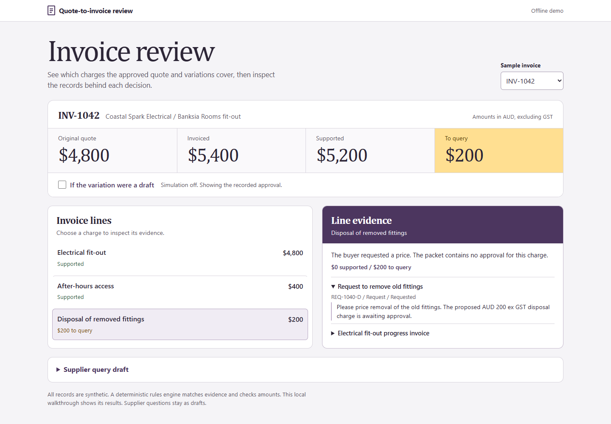

# Invoice Review

An operations manager has a $5,400 supplier invoice and a $4,800 quote. Which extra charges have supporting paperwork? This small, read-only application puts each invoice line beside its evidence and drafts a question for the supplier.

**[Read the case study and try both replies](https://safehavenau.github.io/invoice-review/case-study/)** to see how two replies to the same email change the amount to query.

**[Write your own approval reply](https://safehavenau.github.io/invoice-review/demo/email-approvals.html#write-reply)** · **[Review the original invoice and variations](https://safehavenau.github.io/invoice-review/demo/)** · **[Download the example invoice and evidence](samples/INV-1042.pdf)** · **[Read the architecture and pilot plan](docs/v1-plan.md)**

Both walkthroughs use fictional records and work offline. To present them locally, download the repo and open `demo/index.html`.



## The two-minute walkthrough

1. Open the electrical invoice, **INV-1042**. Of the $5,400 billed, the recorded paperwork supports $5,200.
2. Select the $200 disposal line. The source asks the supplier to **price** removal. The reviewer still needs evidence that the buyer agreed to pay for it. Open the draft supplier question.
3. Select the $400 after-hours line and inspect the approved variation. Switch to the draft-variation scenario. The same work description now leaves $600 to query. Switch back to restore the recorded view.
4. Open the painting invoice for a clean match, or the joinery invoice to see a shared allowance and an ambiguous line.

## Find the approval email

Open the [email walkthrough](https://safehavenau.github.io/invoice-review/demo/email-approvals.html), select **Clear reply**, and review the evidence. The sample Xero-format supplier bill includes a $400 after-hours visit and $200 for disposal. The app matches the supplier and the job reference on the bill, then passes the two matching conversations to the reader. You can inspect a third conversation to see why an approval for the same amount at Fern Hall belongs to a different job.

Choose **Unclear reply** and review again. This time, the electrician offers two options at $400 each. The buyer replies “Yes, go ahead.” The saved AI reading flags the missing choice and proposes a clarification. That leaves $600 to query. Click a quoted passage to open the original message.

Choose **Write your own reply** to answer the two-option email as Jo Bell, the buyer. Try “Please book Thursday after closing for $400 ex GST.” Then change it to “Please book the extra installer on Friday for $400 ex GST.” The price is identical. Only the first reply supports the billed after-hours visit. Each result shows your words, the reason for the finding and the amount still to query. An open charge includes a question for the reviewer to ask. [Open the reply editor](https://safehavenau.github.io/invoice-review/demo/email-approvals.html#write-reply)

**How the AI reads your reply.** A small English text classifier trained on fictional replies runs when you choose **Analyse my reply**. It estimates whether the wording expresses approval, refusal, a condition, a question or uncertainty. Purchasing rules then check the offered work, amount, job and buyer's spending limit. They flag conflicting terms or unfamiliar wording for a person to review. The explanation and suggested question come from the check that produced the finding. The analysis runs in your browser. The page neither sends nor saves your reply. [Training examples](invoice_review/data/reply_training.json) · [Purchasing checks](demo/reply-policy.js)

**How the two saved examples were made.** A Codex language model read the fictional email packets during development. It received the candidate emails and bill lines without expected outcomes or scenario labels. It selected message IDs, quoted the relevant words and explained its reading. The build checks the input fingerprint and exact quotations, checks the sender and spending limit for supported extras, and adds the figures in integer cents. The $4,800 base line comes from the accepted quote. [Reading prompt](docs/email-reading-prompt.md)

The sample [accounts payable bill](invoice_review/data/xero_bill.json) follows the shape of Xero's Accounting API. Figures in the walkthrough exclude GST. Thread-level job and supplier tags and the approver list are provided by the [fictional mailbox fixture](invoice_review/data/approval_mail.json). A live pilot would need a reliable source for these fields. [Xero invoice documentation](https://developer.xero.com/documentation/api/accounting/invoices)

“Supported” describes the scope and price visible in this packet. The person reviewing the invoice still decides whether the work was delivered and what happens next.

| Sample packet | Billed | Supported | To query | What it exercises |
| --- | ---: | ---: | ---: | --- |
| [INV-1042 · Electrical](samples/INV-1042.pdf) | $5,400 | $5,200 | $200 | An approved variation and an unapproved request |
| [INV-1043 · Painting](samples/INV-1043.pdf) | $980 | $980 | $0 | Two lines covered by an accepted quote |
| [INV-1044 · Joinery](samples/INV-1044.pdf) | $940 | $800 | $140 | $100 over a shared allowance and $40 with an ambiguous description |

All names and records are fictional. Amounts shown for review are AUD excluding GST. Page two of each PDF contains the purchasing evidence. The original invoice walkthrough and PDFs use `invoices.json` and `evidence.json`; the email walkthrough uses the sample Xero bill, mailbox and published [AI readings](invoice_review/data/approval_ai_reads.json).

## Connect an assistant

Use Python 3.12 and [uv](https://docs.astral.sh/uv/). In the repo directory, run `uv sync --locked`. An MCP host launches the local server with `uv run --locked invoice-review-mcp` and communicates over standard input and output.

For Claude Code, run the following once in the project where you want to use the connection. Replace the quoted path with the absolute directory containing this README. The command registers the server with local scope. [Claude Code MCP documentation](https://code.claude.com/docs/en/mcp)

```sh
claude mcp add --transport stdio --scope local invoice-review -- uv --directory "/absolute/path/to/invoice-review" run --locked invoice-review-mcp
```

Then ask: **“Which invoice has the largest amount to query? Show the amount, the source record for each disputed line and a draft supplier question.”** Follow up with **“On INV-1042, treat the after-hours variation as a draft. Which figures changed and why?”**

| MCP tool | Returns |
| --- | --- |
| `list_invoice_exceptions()` | Recorded exceptions, sorted by amount to query |
| `get_invoice_review(invoice_id, scenario="recorded")` | Amounts in integer cents, each line's reason and source IDs, and a draft question |
| `get_source_record(source_id, scenario="recorded")` | Document type, effective status and the underlying excerpt |
| `get_approval_email_packet(example="clear" or "unclear")` | Sample bill extras and eligible original emails for a connected assistant to interpret afresh |

Pass `variation_draft` on both the original review and source lookup to inspect the hypothetical document status for INV-1042. To try your own assistant on email, ask it to call `get_approval_email_packet` with `unclear` and explain which work was approved, quoting message IDs. The two walkthroughs are independent evidence examples for the same bill.

## Try the API, SQL report and tests

```sh
uv run --locked invoice-review-api
```

The API starts on `127.0.0.1:8000`. Visit `/docs` for Swagger UI or `/openapi.json` for the contract. The Swagger interface loads its browser assets from a CDN. Example: `GET /invoices/INV-1042?scenario=variation_draft`. Use `GET /sources/VAR-1040-A?scenario=variation_draft` to inspect the matching state.

```sh
uv run --locked python -m unittest discover -s tests -v
uv run --locked python scripts/evaluate.py
uv run --locked python scripts/report.py
node --test tests/custom_reply.test.cjs
```

The evaluation compares supported cents and cited evidence IDs against four labelled fixture cases covering twelve line decisions. The SQL report aggregates the recorded cases by supplier using SQLite. The three invoices have $340 to query in total. The hypothetical draft scenario is excluded from the report.

## Run the server in Docker

```sh
docker build -t invoice-review-demo:0.1 .
docker run --rm -i invoice-review-demo:0.1
```

The default process is the stdio MCP server, so a terminal will wait for protocol input. To run the HTTP API instead:

```sh
docker run --rm -p 127.0.0.1:8000:8000 invoice-review-demo:0.1 uvicorn invoice_review.http_api:app --host 0.0.0.0 --port 8000
```

## Repo map

```text
invoice_review/core.py         matching, money and source rules
invoice_review/email_review.py Xero bill parsing, email selection and evidence checks
invoice_review/data/           fictional bills, job records, emails and saved AI readings
invoice_review/mcp_server.py   local MCP tools
invoice_review/http_api.py     read-only HTTP interface and OpenAPI schema
demo/                          self-contained browser demo and template
samples/                       printable invoice and evidence packets
eval/cases.json                labelled line amounts and expected references
sql/exception_report.sql       supplier exception report
scripts/                       evaluation, reporting and artifact generation
tests/                         business rules, HTTP contract and MCP protocol
docs/v1-plan.md                architecture, integrations and next experiment
```

Regenerate the browser pages with `python scripts/build_demo.py` and `python scripts/build_email_demo.py`. Both generators use the Python standard library. After editing the reply training examples, run `python scripts/train_reply_model.py` before rebuilding the email page. To refresh a saved reading after changing its inputs, supply the output of `invoice_review.email_review.model_input(example)` and the published reading prompt to a model. Save its response in the corresponding entry of `approval_ai_reads.json` with the new `input_digest(payload)`, then rebuild and test. Regenerate the printable invoices with `uv run --no-project --script scripts/build_samples.py`.
