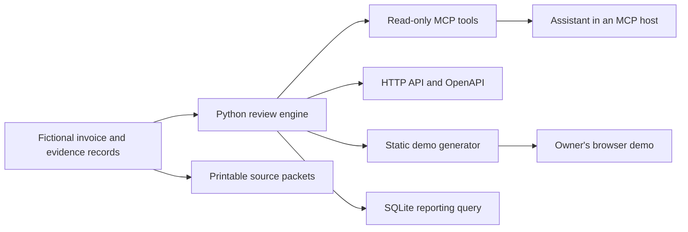

# First release and technology map

## Buyer and decision

Start with an operations manager at a facilities or property maintenance business that buys subcontract work. They have a supplier bill, an accepted quote and later changes to the job. They need to know which lines to query and which document to open. An event operator buying venue services could use the same workflow with different records.

The current release reviews one fictional bill per job against one accepted quote and its accompanying records. A later contract would connect that customer's actual accounting and job records, establish the authoritative quote revision, and account for allowances already used on earlier bills. Useful discovery questions are “Who accepts a variation?”, “Where is that decision recorded?” and “Show me the last invoice you held up. Which documents settled it?”

## Architecture and ownership of decisions

| Step | Current behaviour | Reason |
| --- | --- | --- |
| Find a candidate | Normalise a line description and match a known alias within the supplied job and supplier. Several possible work items leave the line open. | An unfamiliar or ambiguous description should be visible to the reviewer. |
| Check support | Accept an allowance from an accepted quote or approved variation. Count an attachment once and draw down its remaining allowance across the invoice lines. | A request to price work does not establish approval. Two billed visits can share one allowance. |
| Explain the amount | Return integer cents, a reason, and source IDs. Source lookup returns the excerpt and its status in the chosen scenario. | The owner can check both the arithmetic and its basis. |
| Decide what happens next | Display a draft question. The reviewer decides whether to follow up and authorises any separate payment process. | The application verifies the supplied paperwork. Delivery, earlier billings and payment decisions require additional records. |

The browser uses a static snapshot generated by the same functions that answer the live MCP and HTTP requests. It can be shared as a single HTML file. A single-user stdio session is sufficient for the local MCP demo. A hosted, multi-client deployment would additionally need authenticated identities, tenant-scoped source reads and an audit trail tied to each reviewer.

## Business systems to investigate

The engineering environment in the brief describes technologies a team may hire for. A customer's source systems are a separate discovery question. These documented product examples give a first pilot somewhere to start.

| Business environment | Candidate inputs | What to establish with the buyer |
| --- | --- | --- |
| Trade and maintenance business using Xero and ServiceM8 | Read supplier bills and line items from Xero. Use the job system's notes or attachments to locate the accepted scope. ServiceM8 documents the accounting integration and job history. | Obtain a stable job-to-bill reference and identify the actual record of supplier variation approval. A customer-facing sales quote is a different document from a supplier quote. [Xero Accounting OpenAPI](https://github.com/XeroAPI/Xero-OpenAPI/blob/master/xero_accounting.yaml) · [ServiceM8 and Xero](https://www.servicem8.com/au/xero-integration) |
| Construction or fit-out operator using Buildertrend | Its change-order workflow records scope, cost and approval status. A customer's accounting system may hold the bill. | Check whose approval is required and whether the saved record authorises the specific supplier cost. Owner approval of a sales price and acceptance of a subcontract cost can be separate events. [Buildertrend change orders](https://buildertrend.com/help-article/change-order-overview/) |
| Enterprise finance team using Dynamics 365 Finance | Existing two-way and three-way matching can already compare vendor bills with orders and receipts. | Ask for exceptions that still require a reviewer to find evidence outside the accounting system. Measure the value of resolving those exceptions. [Microsoft invoice matching](https://learn.microsoft.com/en-us/dynamics365/finance/accounts-payable/accounts-payable-invoice-matching) |

For the first pilot, request one supplier bill export and the corresponding approval packets. Record the source ID, supplier, job, line amount, approval state and who owns each field before writing a vendor connector. No live vendor integration ships in this version.

## Fit to an applied AI engineering environment

| Technology | Where it earns its place |
| --- | --- |
| Python, SQL and Git | Current release. Python owns the review logic and its tests. A SQLite query rolls reviewed lines up to supplier totals. Source, labelled cases and generated examples can be reviewed together in Git. |
| Claude Code and other AI-assisted development tools | Claude Code can connect as an MCP host and request evidence. For development, a contributor can use their preferred coding assistant and verify changes against the versioned fixtures and protocol tests. [Claude Code MCP](https://code.claude.com/docs/en/mcp) |
| LLM agents, function calling and MCP | The shipped MCP server exposes three typed, read-only tools. A connected assistant can choose which one to call and explain its results. The regression suite uses a real protocol client. Actual model behaviour and cost require a separately measured run. [Official MCP SDK](https://github.com/modelcontextprotocol/python-sdk) |
| Retrieval-augmented generation and orchestration frameworks | Next experiment. Retrieve candidate passages from the same supplier and job, then ask a model to suggest a scope item and cite its passage. Pass the candidate through the existing approval and arithmetic checks. Start with one tool-using assistant. Add an orchestration framework when steps need resumable state, retries or human sign-off across sessions. |
| Docker and Swagger/OpenAPI | Current release. The container runs the MCP server or HTTP service. FastAPI publishes a typed OpenAPI contract and Swagger UI for the read-only endpoints. [FastAPI features](https://fastapi.tiangolo.com/features/) |
| Postgres and Elasticsearch | Move the operational ledger to Postgres when multiple users need durable records, consistent balances across bills and tenant permissions. Add Elasticsearch when enough text exists to compare keyword and semantic retrieval against the baseline. [Elasticsearch hybrid search](https://www.elastic.co/docs/solutions/search/hybrid-search) |
| Spark and Databricks | Use a historical invoice corpus for batch import, normalisation and evaluation once volume justifies distributed processing. Keep the online review request small. [Databricks and Apache Spark](https://docs.databricks.com/aws/en/spark) |
| Redshift | If the customer already reports in Redshift, publish a reviewed-line fact table for exception trends and pilot measurement. The SQLite report demonstrates the grain and aggregation on local data. [Amazon Redshift](https://docs.aws.amazon.com/redshift/latest/mgmt/welcome.html) |
| AWS, Azure and Kubernetes | Deploy a container in the customer's existing AWS or Azure environment once a private pilot needs shared access. Use Kubernetes when the customer already operates a cluster or needs its deployment controls. The public browser demo needs only static hosting. [Azure Container Apps](https://learn.microsoft.com/en-us/azure/container-apps/overview) · [Kubernetes deployments](https://kubernetes.io/docs/concepts/workloads/controllers/deployment/) |

## Acceptance and next experiments

**Current acceptance cases.** The $5,400 invoice yields $5,200 supported and $200 to query. Changing the $400 variation to draft yields $4,800 supported and $600 to query. A $980 painting bill is fully supported. The $940 joinery bill leaves $140 open. The evaluation checks the supported amount and source IDs on every line. These are fixture results for a deterministic baseline.

**Next AI experiment.** Collect a separately labelled set of unfamiliar descriptions with known correct source IDs, including near-matches from the wrong job, missing approvals and ambiguous items. Hold it out of the alias list. Compare the current matcher with model-assisted retrieval on the same cases. Track unsupported cents incorrectly marked supported, correctly identified approvals, missed approvals, cost and latency. Report a useful failure alongside each improvement.

**First buyer pilot.** Select one reviewer and one supplier workflow. Record the manual decision and review time on representative bills. Use a paired or counterbalanced comparison on the same cases, with an independent check of disputed outcomes. Report time per review alongside erroneous support and correction counts. Record frequency, time and rework before turning a result into a savings claim.
